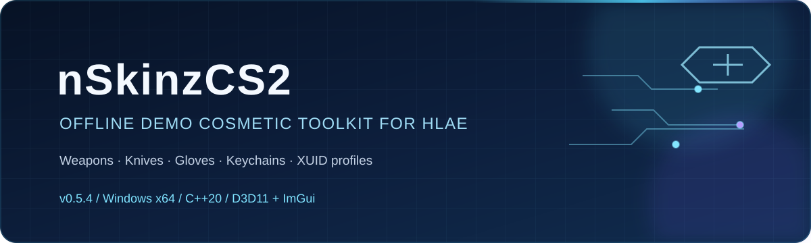
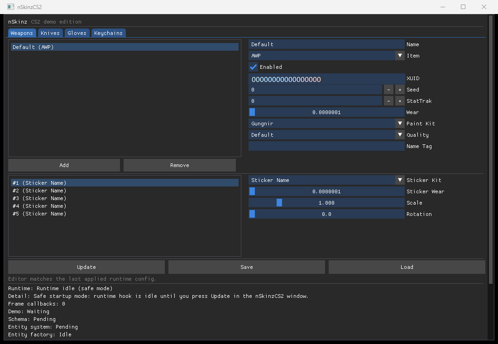

[](./docs/assets/nskinz-banner.svg)

<h3 align="center">面向 HLAE Demo 回放的 Counter-Strike 2 离线外观工具</h3>

<p align="center">
  <a href="https://github.com/Lyan-edit/CS2-nskinz/blob/main/README.md"></a>
  <a href="https://github.com/Lyan-edit/CS2-nskinz/blob/main/README.zh-CN.md"></a>
</p>

<p align="center">
  <a href="https://github.com/Lyan-edit/CS2-nskinz/releases/latest"></a>
  <a href="https://github.com/Lyan-edit/CS2-nskinz/releases"></a>
  <a href="https://github.com/Lyan-edit/CS2-nskinz"></a>
  <a href="https://github.com/Lyan-edit/CS2-nskinz/network/members"></a>
  <a href="https://github.com/Lyan-edit/CS2-nskinz/issues"></a>
  
  
  
</p>

<p align="center">
  <a href="https://github.com/Lyan-edit/CS2-nskinz/releases/download/v0.4.3/nSkinzCS2.dll"></a>
  <a href="https://github.com/Lyan-edit/CS2-nskinz/releases/download/v0.4.3/nSkinzCS2.zh-CN.dll"></a>
  <a href="https://github.com/Lyan-edit/CS2-nskinz/releases/tag/v0.4.3"></a>
  <a href="https://github.com/Lyan-edit/CS2-nskinz/issues/new/choose"></a>
</p>

> **安全提示：** nSkinzCS2 只用于通过 HLAE、带 `-insecure` 启动的离线 Demo 回放。请勿加载到 VAC 保护服务器或任何联机服务器。超出此范围使用造成的账号风险由使用者自行承担。

## v0.4.3 更新

- 按本机涂装元数据选择新旧枪械网格，修复 M4A4 从破浪狂飙换成皇帝仍显示原皮的问题。
- 修复网络实体缓存之外的第一人称枪身漏查；当前活动枪身应存在但尚未解析时，在任何外观写入之前保持等待状态。
- 枪械涂装列表按精确枪型兼容关系筛选；运行时和导入配置同样校验。保留完整目录，不兼容选项明确显示“不可用”，不会被偷偷改成原皮。
- 枪械刷新缓存增加实体身份与创建代际校验；对象未变、收枪或修复被回放覆盖的字段时不重复刷新。
- 保留独立面板输入法/搜索修复、静态 MSVC `/MT` 与内嵌着色器。独立刀模链保持只读，尚未完成可用的模型替换。

用户已确认本地 Demo 的皇帝修复成功。**45 项原生回归**、**8 个定向检查**、双语构建及隔离加载/渲染检查通过。目录覆盖 **34 枪型 / 1,449 个合法组合**，不代表逐个涂装都完成了画面实测。详见[中英双语 v0.4.3 发布说明](docs/releases/v0.4.3.md)。

<details>
<summary>保留的 v0.4.1 修复</summary>

- 修复使用输入法、在皮肤搜索栏输入文字导致 CS2 闪退的问题，包括英文输入触发的崩溃。完整控制面板现运行于 `cs2.exe` 之外，通过系统自带的 `rundll32.exe` 承载，无需额外下载程序。
- 独立面板保留本机游戏的完整皮肤目录及中文名称，不以缩减涂装选项规避输入问题。
- 修复枪械动态涂装属性同步和刀材质重复刷新。
- “仅饰面”隐藏并忽略刀模型选择，只有“饰面＋模型”才显示模型选项。
- 移除网格更新中的阻塞等待/重试、运行时反复复制完整目录，以及帧回调内同步写日志的开销。

v0.4.1 发布时通过 **42 项原生回归测试**。网格函数 240 次更新的基准从 3714 毫秒降至约 0.1 毫秒；这**不是游戏帧率实测，也不代表所有 Demo 卡顿都已解决**。验证范围和已知限制见[中英双语 v0.4.1 发布说明](docs/releases/v0.4.1.md)。

</details>

## nSkinzCS2 是什么？

nSkinzCS2 是一个 Windows x64 DLL，用于在观看 Counter-Strike 2 Demo 时修改当前观战玩家的外观。它通过 HLAE 的 `mirv_loadlibrary` 加载，读取本机 CS2 目录中的物品目录，并通过 Win32 + D3D11 + Dear ImGui 控制面板，按玩家 XUID 安全地应用外观覆盖。



## 功能矩阵

| 模块 | v0.4.3 支持情况 | 说明 |
| --- | --- | --- |
| 枪械 | 按枪型筛选的涂装、种子、磨损、品质、名称标签和贴纸字段 | 运行时及导入配置同样校验兼容性；新旧网格跟随目标涂装元数据。 |
| 刀 | 饰面、种子和磨损；保留饰面＋模型界面入口 | 仅饰面隐藏模型选项；独立模型适配器仍只读，模型与动画替换尚未完成。 |
| 手套 | T/CT 默认手套、手套模型和涂装 | 已在当前兼容版本验证默认手套定义 `5028`、`5029`。 |
| 挂件 | 修改或清除已有实时模块 | 对没有挂件模块的物品创建模块仍属实验功能。 |
| 原皮 / 无涂装 | 独立的 `原皮（无涂装）` 选项 | 与 `-（不修改）` 不同；部分 Demo 刀的第一人称旧材质可能残留。 |
| 语言 | 英文和简体中文 DLL | 中文版从本机 `csgo_schinese.txt` 读取名称。 |

## 快速开始

v0.4.3 已内嵌预编译面板着色器并保留 `/MT`。除 Windows 10/11 x64、CS2 和 HLAE 外，不需要安装其它运行库。`LoadLibrary failed` 排查见[单 DLL 加载说明](docs/portable-loading.md)。

1. 使用 HLAE、带 `-insecure` 启动 CS2，然后打开离线 Demo。
2. 下载一个 Release DLL。发布版使用 MSVC 静态运行库（`/MT`），不需要另装 Visual C++ Redistributable、Python、SDK 或 Visual Studio。
3. 在 HLAE 中加载 DLL：

```text
mirv_loadlibrary D:\nSkinzCS2.zh-CN.dll
```

英文版：

```text
mirv_loadlibrary D:\nSkinzCS2.dll
```

上述示例要求 DLL 位于 D 盘根目录，请改成实际完整路径。没有空格时不必加引号；有空格时只加一对英文半角双引号，例如 `mirv_loadlibrary "D:\My Tools\nSkinzCS2.zh-CN.dll"`。不要叠加两对引号或使用中文弯引号。

按 `Insert` 显示面板，选择观战玩家 XUID 和外观配置，点击“更新”（`Update`）。请把 DLL 放在可写文件夹，独立面板与运行时需要在此生成和共享目录/配置文件。运行日志为 `nSkinzCS2.log`，面板日志为 `nSkinzCS2.ui.log`。

升级时请重启 HLAE/CS2，只加载**一个语言版本**的 DLL；先备份旧配置，不要在旧 DLL 已加载时叠加注入新版。[Windows x64 发布包](https://github.com/Lyan-edit/CS2-nskinz/releases/download/v0.4.3/nSkinzCS2-v0.4.3-windows-x64.zip)含中英文 DLL 和加载说明。

## 兼容基线

`v0.4.3` 对应以下已检查基线。皇帝案例已由用户确认；不代表完成了所有 Demo、涂装和帧率测试：

- Steam app build ID `25000182`
- CS2 ClientVersion `2000899`、Patch `1.41.7.8`、Source revision `10948930`（2026-08-28）
- `client.dll` SHA-256：`B8E2C009763E8CEFB88D89A2BDCF452DB17501553D473DB6DA060DF8E6769EB4`
- HLAE `2.191.1`
- `Source2Client002`、`ResourceSystem013`、`VFileSystem017`

CS2 更新可能改变内存布局。DLL 会记录检测到的版本，并在签名缺失或匹配不唯一时拒绝不确定的写入。

<details>
<summary><strong>从源码构建</strong></summary>

要求：Windows 10/11 x64、Visual Studio 2022 + MSVC v143、Windows SDK 10、Direct3D 11 开发库，以及用于目录检查的本地 CS2 安装。

```text
打开 nSkinzCS2.sln
选择 Release | x64       # 英文版
选择 ReleaseZhCn | x64   # 简体中文版
生成解决方案
```

输出文件为 `build/Release/nSkinzCS2.dll`、`build/Release/nSkinzCS2.zh-CN.dll` 和 `build/Release/nSkinzCS2.Tests.exe`。`run-build-and-tests.cmd` 会构建并运行原生回归测试，`run-tests.cmd` 只运行现有测试程序。

</details>

<details>
<summary><strong>仓库结构与架构</strong></summary>

| 路径 | 作用 |
| --- | --- |
| `src/` | 启动、配置、目录解析、运行时、外观辅助逻辑和 ImGui 界面 |
| `tools/` | DIA/RVA 与资源查询辅助程序 |
| `third_party/` | Dear ImGui、MinHook、nlohmann/json 源码 |
| `nSkinzCS2.sln` | DLL 与原生测试项目的 Visual Studio 解决方案 |
| `run-build-and-tests.cmd` | 构建和测试脚本 |

`AppState` 连接启动、UI 和运行时线程；`WeaponAppearance`、`KnifeAppearance`、`GloveAppearance` 将配置决策拆成可在游戏进程外测试的辅助模块；运行时层会先校验接口、签名和实体绑定。

</details>

## 已知限制与路线图

- 刀模替换和部分动画重映射仍属实验功能。
- 如果 Demo 中的刀已经拥有编译后的自定义材质，选择 `原皮（无涂装）` 后第一人称视角仍可能显示旧材质。正数刀涂装已验证；该旧材质清理问题不在 v0.4.3 的已修复声明内。
- 当前优先读取已安装的 CS2 游戏数据，尚未完全改为实时物品 Schema 遍历。

后续计划包括：完善原皮材质清理、扩大刀模/动画覆盖、支持空挂件模块创建，以及跟随 CS2 更新维护兼容性。

## 常见问题

**修复输入崩溃是否禁用了中文，或减少了皮肤？** 没有。完整面板与 CS2 的输入/文字服务路径隔离，并读取导出的本机游戏目录，仍支持中文输入法和英文搜索。如目录异常变少，请反馈两份日志及目录文件的生成状态。

**为什么单把枪的涂装选项变少了？** v0.4.3 只显示与该枪型兼容的涂装，完整本机目录仍保留。兼容数据缺失时拒绝应用；旧配置中的错误组合会标为不可用，不会悄悄变成原皮。

**Demo 仍然卡顿怎么办？** v0.4.1 移除了已确认的阻塞操作，但不保证所有 Demo 都无卡顿。请保留 CS2 运行现场，反馈日志里的 `Runtime performance` 行，以区分游戏回调、外观轮询、网格更新和材质生成的耗时。

**为什么 `-` 不会清除涂装？** `-（不修改）` 的含义就是保持当前值不变。需要明确去除涂装时请选择 `原皮（无涂装）`。

**修改后没有变化。** 请先加载 Demo，确认观战玩家 XUID 和基础物品正确，再点击 `Update`；同时查看 `nSkinzCS2.log` 中的绑定或兼容性错误。

**为什么刀上仍有旧材质？** 部分 Demo 物品带有编译后的第一人称材质，当前 v0.4.3 原皮路径无法保证全部清除，详见上面的已知限制。

**应该下载哪个 DLL？** 英文界面使用 `nSkinzCS2.dll`，中文界面和中文目录名称使用 `nSkinzCS2.zh-CN.dll`；两者兼容同一套 CS2 基线。

**仓库能打开，但图片显示破图标怎么办？** 某些网络无法访问 GitHub 的 raw 图片域名。本 README 已使用 GitHub 推荐的相对图片路径；如果仍然加载失败，可临时用管理员身份打开记事本，编辑 `C:\Windows\System32\drivers\etc\hosts`，追加：

```text
199.232.68.133 raw.githubusercontent.com
199.232.68.133 githubusercontent.com
```

然后运行 `ipconfig /flushdns`，重启浏览器并刷新页面。网络恢复后可删除这两行；如果仓库本身在无痕窗口也返回 `404`，hosts 不能修复账号级公开可见性，需要联系 GitHub Support。

## 贡献与支持

提交 Pull Request 前请阅读 [CONTRIBUTING.md](CONTRIBUTING.md)。安全问题请参考 [SECURITY.md](SECURITY.md)。反馈问题时请附上准确的 CS2 Build ID、HLAE 版本、DLL 语言、复现步骤和经过脱敏的日志片段。

<a name="support"></a>
## ❤️ 支持项目

如果 nSkinzCS2 对你的离线 Demo 工作流有帮助，欢迎自愿支持。下方是作者提供的无 ID 收款码；赞助完全自愿，不代表提供技术支持合同或功能保证。

| **微信支付** | **支付宝** |
| :---: | :---: |
|  |  |

## 致谢与授权说明

nSkinzCS2 使用 Dear ImGui、MinHook 和 nlohmann/json。重新发布修改后的源码或二进制文件前，请阅读 `third_party/` 下的上游声明。本仓库目前暂不添加根目录许可证。

<p align="center"><a href="https://star-history.com/#Lyan-edit/CS2-nskinz&Date"></a></p>

<p align="center"><sub>为可复现的 CS2 离线 Demo 回放而构建。请保持离线并安全使用。</sub></p>
